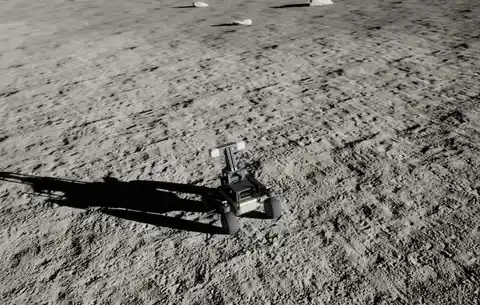
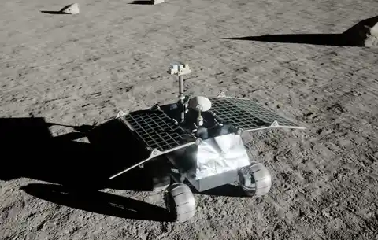
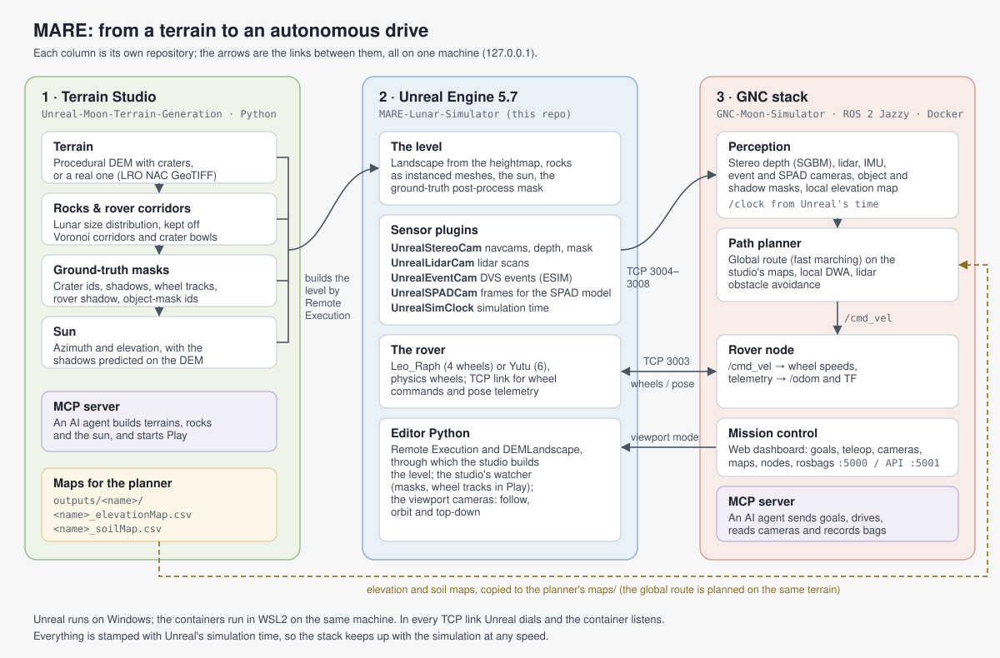
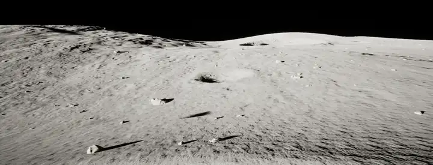
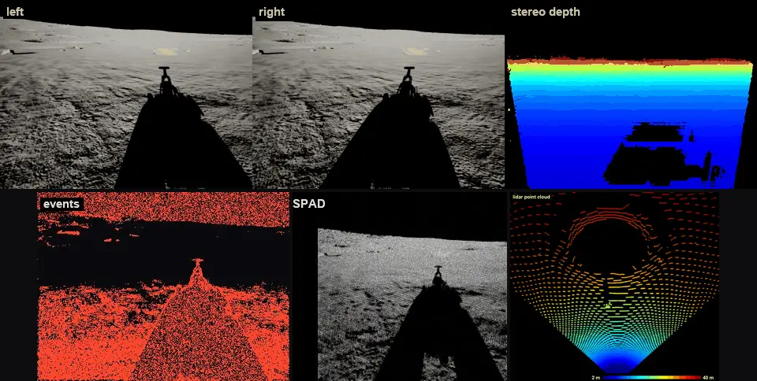
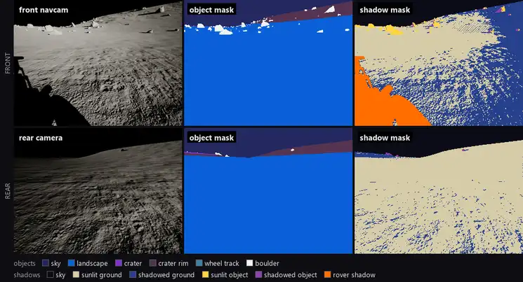
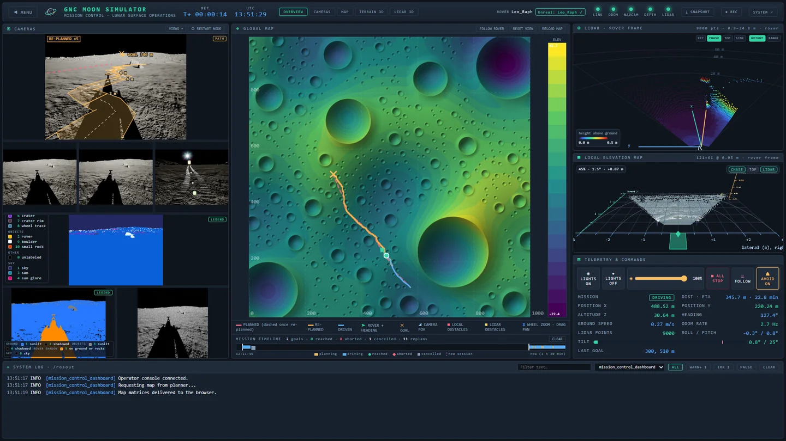

# MARE: Lunar Rover Simulator

**MARE** (*Modular Autonomy and Rendering Environment*, after the lunar maria)
is an open simulation suite for lunar rovers in Unreal Engine 5. It generates
lunar terrain with craters, rocks and a low sun, renders it for the rover's
cameras and sensors with ground truth, and drives the rover autonomously with a
ROS 2 GNC stack, watched from a web mission control.

**Video overview:** [YouTube](https://youtu.be/EI4HgbMFbBE) · **Project page:** [raulcastar.me/mare](https://raulcastar.me/mare/)

| Leo_Raph | Yutu |
|---|---|
|  |  |

*Both rovers driving themselves to a goal past rocks with the same GNC stack,
seen from Unreal's orbit camera (6x speed). Videos at 2x:
[Leo_Raph](docs/videos/raph_drive.mp4), [Yutu](docs/videos/yutu_drive.mp4).
Leo_Raph is a model of Fictionlab's [Raph Rover](https://fictionlab.pl/raph-rover/); Yutu is adapted from a
public model of the Chang'e 3 rover.*

This repository is the Unreal project. It holds the levels, the rovers and the
sensor plugins, and it is the centre of the suite:

| Repository | Role |
|---|---|
| **MARE-Lunar-Simulator** (this one) | Unreal Engine 5.7 project: levels, rovers (Leo_Raph, Yutu), sensor plugins |
| [Unreal-Moon-Terrain-Generation](https://github.com/raulcastar/Unreal-Moon-Terrain-Generation) | Terrain Studio: terrain, craters, rocks, ground-truth masks and the sun, built in Unreal |
| [GNC-Moon-Simulator](https://github.com/raulcastar/GNC-Moon-Simulator) | ROS 2 GNC stack in Docker: perception, path planning, rover control, mission control |
| [UnrealStereoCam](https://github.com/raulcastar/UnrealStereoCam), [UnrealLidarCam](https://github.com/raulcastar/UnrealLidarCam), [UnrealEventCam](https://github.com/raulcastar/UnrealEventCam), [UnrealSPADCam](https://github.com/raulcastar/UnrealSPADCam), [UnrealSimClock](https://github.com/raulcastar/UnrealSimClock) | The sensor plugins, each usable in any Unreal project (copies in `Plugins/`) |

## The pipeline



1. **Terrain Studio** generates a DEM (or loads a real one), plans a rock field around drivable corridors, and builds both in Unreal with the ground-truth masks and the sun.
2. **Unreal** simulates the rover and renders its sensors: stereo navcams with depth and object masks, lidar, event and SPAD cameras, all stamped with the simulation time.
3. **The GNC stack** turns the sensor streams into depth and local maps, plans a route on the same DEM, and drives the rover back through Unreal.

Step by step, with what each link carries: [docs/pipeline.md](docs/pipeline.md).

## What it looks like

**Terrain.** A 300 × 300 m mare from Terrain Studio, with its 974 planned rocks
under a 10° sun, and the studio's predicted shadows next to Unreal's as the sun
sets ([video](docs/videos/flyover.mp4)):




**Sensors.** Stereo depth, lidar, event and SPAD cameras on the rover:



**Ground truth.** The navcams and the rear camera come with pixel-exact masks
of object classes and shadows, including the rover's own shadow and its wheel
tracks:



*The front navcam and the rear camera during a drive, with their ground-truth object
masks and shadow masks (2.4x speed; [video](docs/videos/ground_truth.mp4) at 1.2x). Ahead, the rover's own
shadow (orange) is labelled apart from the terrain's shadows; behind, the wheel
tracks it leaves are their own class in the object mask.*

**Mission control.** The web dashboard during a drive: navcams with the planned
path, masks, global map, lidar, local elevation map and telemetry:



## Requirements

- Windows 10/11 with Unreal Engine **5.7** and Visual Studio 2022 (*Game development with C++*), to build the plugins on first open.
- [Git LFS](https://git-lfs.com): the assets and levels are stored in LFS.
- For the GNC stack: WSL2 and Docker (ROS 2 Jazzy runs in the containers).
- A recent GPU (the project uses Lumen and virtual shadow maps), and about 32 GB of RAM to run Unreal and the stack together.

## Quick start

```sh
git lfs install                # once: the Unreal assets are in Git LFS
git clone https://github.com/raulcastar/MARE-Lunar-Simulator.git
git clone https://github.com/raulcastar/GNC-Moon-Simulator.git
git clone https://github.com/raulcastar/Unreal-Moon-Terrain-Generation.git
```

Clone them side by side; what each is for, and the plugin repositories:
[docs/setup.md](docs/setup.md#clone-the-suite).

1. Open `Moon_Simulator.uproject` and let Unreal build the plugins ([docs/setup.md](docs/setup.md)). It opens on `Lunar_Terrain_Raph`.
2. Start the GNC stack ([GNC-Moon-Simulator](https://github.com/raulcastar/GNC-Moon-Simulator#quick-start)), press **Play**, and open mission control at http://127.0.0.1:5000 to send the rover to a goal.
3. To build your own terrain, run [Terrain Studio](https://github.com/raulcastar/Unreal-Moon-Terrain-Generation#quick-start) with the editor open.

## AI agents

Two MCP servers let an AI agent (Claude Code, Claude Desktop or any MCP client)
run the suite end to end: Terrain Studio's builds terrains, rocks and the sun
in Unreal and starts Play; the GNC stack's sends goals, drives, reads the
cameras and records bags. See each repository's README.

## Documentation

| | |
|---|---|
| [Pipeline](docs/pipeline.md) | The full workflow, from a terrain to an autonomous drive, and every link between the parts |
| [Setup](docs/setup.md) | Cloning with LFS, TAPython, building the plugins, connecting the other repositories |
| [The Unreal project](docs/project.md) | Levels, rovers, plugins, content layout, project settings, editor Python |
| [Rovers](https://github.com/raulcastar/GNC-Moon-Simulator/blob/main/docs/rovers.md) | Leo_Raph and Yutu, switching rovers, physics tuning (GNC docs) |

## License

[MIT](LICENSE), © 2026 Raul Castilla Arquillo, except the third-party content
listed in [THIRD_PARTY_NOTICES.md](THIRD_PARTY_NOTICES.md): the Poly Haven
landscape textures and rocks (CC0), the Yutu model (CC-BY-4.0), TCP-Unreal
(MIT), the ESIM event model (MIT), TAPython (its author's terms) and Unreal
Engine (Epic's EULA).
