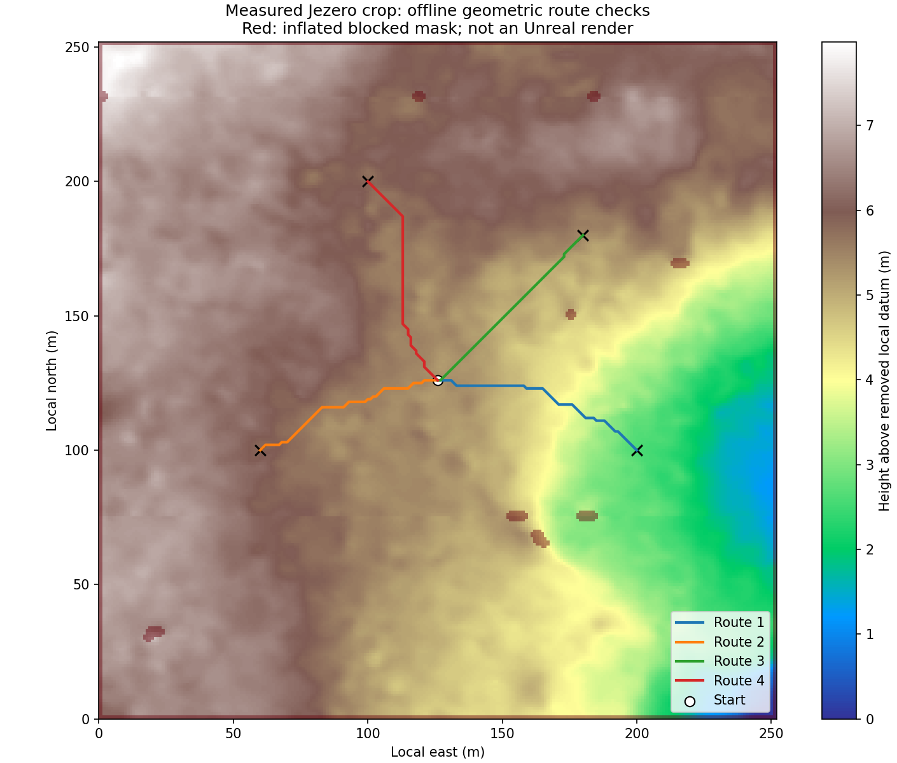

# Jezero'da ROS kullanmadan hedefe gitme

Bu ek, mevcut MARE TCP sensörlerini Python yol planlama ve görev kontrolüne
bağlar. Küresel harita ölçülmüş Jezero DEM'idir; konum Unreal'ın simülasyon
telemetrisidir. Bu bir SLAM veya NASA uçuş yazılımı uygulaması değildir.
Kum, batma ve çekiş modeli bu aşamanın kapsamı dışındadır.

Gerçek UE 5.7 çalıştırması geliştirme ortamında yapılmadı. Kullanıcının native
QA04 ve QA03 testleri her iki statik arazi modunda geri okuma ve örneklenmiş
collision sonucunu doğruladı. Aşağıdaki akışın Python algoritmaları ve TCP
protokolleri test edildi; gerçek motor/sensör/rover kabulü hâlâ bekler. Kaynak
araştırması ve entegrasyon kararları
[yıldızlı depo incelemesindedir](mars-starred-review.md).

## Kurulum ve yeni seviye

[Mars ortamını](mars-jezero.md) kurun: fork'un `codex/mars-jezero-reviewed`
dalını çekin, `git lfs pull` çalıştırın ve UE 5.7 C++ pluginlerini derleyin.
Unreal dışında Python **3.12** terminalinde, repo kökünde:

```bash
python -m pip install -r requirements-mars-dev.txt
python -m pytest tests -q
```

Üretim için temel `requirements-mars.txt`, stereo tahmini istenirse ayrıca
`requirements-mars-stereo.txt` yeterlidir. NumPy/OpenCV/rasterio'yu Unreal'ın
gömülü Python'una kurmayın. Editor tarafı standart kütüphane kullanır.

Play kapalıyken, açık çalışmayı kaydedin. Unreal Output Log'u Python yapın;
aşağıdaki `C:/...` yollarını kendi **repo klasörünüzle** değiştirin:

```python
import mars_setup
job = mars_setup.build(
    level_path="/Game/Mars/JezeroNav",
    rover_blueprint="/Game/Blueprints/Leo_Raph",
    navigation_config_path=r"C:/work/MARE-Lunar-Simulator/Saved/Mars/jezero-sensors.json",
    report_path=r"C:/work/MARE-Lunar-Simulator/Saved/Mars/jezero-nav-import.json",
)
```

`job['status'] == 'saved'` olmasını ve raporda `heightmap_verified=true`,
`collision_verified=true` bulunmasını bekleyin. İşlem mevcut seviyeyi
değiştirmez; yeni ad ister. Daha önce oluşturduğunuz ad varsa yeni bir seviye
ve yeni JSON adı seçin. İçe aktarım sırasında dünya değiştirmeyin veya Play
başlatmayın. Önceki başarısız denemeden kalan dosyaların üzerine yazılmaz.

`mars_sensor_setup.py`, yerleştirilen rover'ın gerçek `base_link`, LiDAR ve
kamera bileşenlerinden sensör dönüşümlerini, kimliklerini, FOV'u, çözünürlüğü
ve stereo baseline'ı çıkarır. Bir URDF montajı tahmin edilmez. Paralel olmayan
stereo gözler reddedilir; bu adaptör genel kamera rektifikasyonu yapmaz.
Yalnızca bu yeni seviyedeki sensörler, Play öncesinde localhost'a ayarlanır:
LiDAR 10 Hz, kamera 5 Hz, merkez ground-truth depth açık, pozlama EV100=13.
Pozlama bir deney ayarıdır; Mars kamerası radyometrik kalibrasyonu değildir.
`native_sensor_stream_verified` ve `native_rover_motion_verified` dışa
aktarımda **false** kalır; bileşen ölçümü gerçek akış testi yerine geçmez.

## Servisi başlatma ve haritadan hedef seçme

GNC Docker çalışıyorsa aynı portları kullanan bileşenleri GNC klasöründen durdurun:

```bash
docker compose stop component_rover_leo_raph component_path_planner component_lidar component_stereo_depth
```

Aynı anda `mars_rover.bridge` veya başka kamera/LiDAR sunucusu çalıştırmayın.
Bu servis motor köprüsünü zaten içerir. **Önce servis, sonra Unreal Play:**

```bash
python -m mars_rover.nav_service --sensors Saved/Mars/jezero-sensors.json
```

Bu komut katı JSON telemetrisi bekler. Kullanıcının 29 Ekim 2026'daki TCP
kaydında doğrulanan Türkçe sayılı eski Blueprint çıktısı için, yalnızca Unreal
üreticisinin bu biçimi kullandığı simülasyon koşusunda komuta
`--telemetry-format unreal-tr-v1` eklenebilir. Mod üretici yerel ayarını
otomatik denetlemez; ayar değişirse bazı sayılar yanlış yorumlanabilir.
Bu geçici uyumluluk katmanı ve ham kayıt için
[Windows test rehberindeki §4.8'e](mars-windows-full-test.md#48-rover-telemetrisi-ayrışmıyorsa-ham-tcp-tanısı)
bakın. Gerçek ve yerel ayardan bağımsız JSON üretimi ayrı geliştirme gerektirir.

Tarayıcıda <http://127.0.0.1:8766> açın. Haritadan bir nokta seçip **Hedefe git**
düğmesine basın. Kuzey yukarı, doğu sağdır; koordinatlar yerel metredir.
Kırmızı katman, eğim/basamak/sınır ve rover engel payı nedeniyle kapalı alanı
gösterir. Yeşil çizgi planlanan rota, mavi nokta telemetri konumudur.
Arka plan gerçek HiRISE gri referansıdır; Unreal navcam canlı yayını değildir.
Unreal viewport'u ile sürüşü ayrıca izleyin. Bir hedef başlangıçta da verilebilir:

```bash
python -m mars_rover.nav_service --sensors Saved/Mars/jezero-sensors.json --goal 200 100
```

Rover'ın fizik yerleşmesini bekleyin. En az iki saniyelik poz geçmişinde
2 cm / 2 derece kararlılık aranır; fizik yerleşmesi toplamda daha uzun
sürebilir. Pozlar arasında 0.25 s'den uzun boşluk bu pencereyi geçersiz kılar.
Sonra taze LiDAR ve seçilen derinlik kaynağı olmadan hareket
başlamaz. Örnek görev durumları `waiting_for_settle`, `waiting_for_sensors`,
`following`, `replanning`, `arrived`, `blocked` olarak görünür.

## Kontrol ve sensör sözleşmesi

| Bağlantı | Biçim / rol |
|---|---|
| TCP 3003 | Mevcut Blueprint'in dört teker motor komutları ve `base_link` dünya telemetrisi |
| TCP 3004 | Mevcut UnrealStereoCam `NAVF` v2: BGRA8 veya merkez düzlemsel depth float32 **cm** |
| TCP 3007 | Mevcut UnrealLidarCam `LIDR` v1: 48 bayt başlık; 20 bayt/nokta; sensör FLU **metre** |
| HTTP 8765 | Eski Python motor API'si; manuel komut veya `/stop` aktif hedefi iptal eder |
| HTTP 8766 | `/goal`, `/stop`, `/status`, `/map` ve görev arayüzü |

LiDAR zaman damgası epoch tabanlı `GncSimTime` double saniyedir. NAVF v2 ve
telemetri tam sayı nanosaniye kullanır. `t_ns` eksikse yerel varış saatiyle
yerine konmaz; rover hareket etmez. NAVF v1 yalnızca oynatma içindir.
Capture anını çevreleyen pozlar arasında dönüşüm yapılır; geç gelen görüntü
rover'ın şimdiki pozuna yapıştırılmaz. LiDAR epoch yuvarlamasına 1024 ns
sayısal tolerans, poz aralığına en çok 0.25 s izin verilir.

Harita `x=doğu, y=kuzey, z=yukarı` metre; UE dünya konumu
`(-x,y,z)*100` cm'dir. LiDAR zaten kendi FLU çerçevesindedir, yeniden global
ayna uygulanmaz. Kamera optik eksenleri sağ/aşağı/ileri; depth eksenel Z'dir,
ışının uzunluğu değildir. Roll/pitch/yaw ve gerçek sensör montajı birlikte
kullanılır. Kalibrasyon sonrası kamera boyutu değişirse akış reddedilir.

20 Hz hedefli kontrol döngüsü, poz yaşı 0.3 s veya sensörün varış/capture yaşı 0.4 s
sınırını geçtiğinde durur. Her iki sensörden harita içinde en az 20 sonlu
nokta gerekir. En fazla 8 m sensör noktaları kullanılır. Bozuk paket ve
bağlantı kapanması sensör sağlığını geçersiz kılar. Bu sayısal eşikler ilk
simülasyon deneyi içindir; gerçek rover başarısı ölçülmeden fiziksel sınır
olarak değerlendirilmez.

Yoğun sensör işlemesi sırasında poz veya sensör verisi eskirse, hesaplanan
hareket komutu veya yeni varış kararı reddedilir (`waiting_for_fresh_data`). Bir komut
zaten üretilmişse, kaynak verinin zaman sınırı köprüdeki örnekleme sırasında
da uygulanır. Paket kilit beklerken geçen süre tazelikten düşülür; stereo
çıktısının yaşı iki girişten eski olanın zamanından başlar. Bunlar Python
tarafındaki korumalardır; ağ tamamen koparsa veya işlem kapanırsa bağımsız
Unreal motor watchdog'unun yerini tutmaz.

`/mission/snapshot` ve `/mission/export` içindeki `control_timing` alanı
servis başlangıcından beri kontrol çevrimlerinin duvar saati sürelerini ve
reddedilen gecikmiş kararların sayısını gösterir. `sensor_health` içindeki
`processing_s`, **son işlenen** LiDAR veya derinlik gözleminin yerel işleme
süresidir. Sayaçlar gecikmenin kaynağını tek başına kanıtlamaz; boşta ve
görev sırasında ayrı ölçülmelidir. Hedef yoksa `expired_decisions=0` olması
hareket komutu korumasının canlı koşuda sınandığı anlamına gelmez. Döngü, işleme
süresi dahil yaklaşık 50 ms aralığı hedefler; 50 ms aşılırsa başka thread'lere
fırsat vermek için en az 1 ms bekler. Gerçek zamanlama işletim sistemine ve
yüke bağlıdır; 20 Hz garanti edilmez. Sensörün yerel alım zamanı paket
çözüldüğünde kaydedilir; işletim sistemi veya ağ tamponundaki önceki bekleme
ayrıca ölçülmez.

`telemetry_timing`, aynı TCP bağlantısında köprü tarafından çözülen telemetri
nesnelerinin sayısını ve ardışık geçerli `t_ns` değerleri arasındaki 250 ms'yi
aşan simülasyon zamanı boşluklarını sayar. Eksik/geçersiz, tekrar eden veya
geriye giden zamanlar ayrıca sayılır; geçersiz değer ardındaki aralık
bilinmediğinden boşluk sayısı tek başına eksiksiz kanıt değildir. Sayaçlar her
yeni rover bağlantısında sıfırlanır. Bunları `/mission/events` içindeki poz
boşluklarıyla karşılaştırmak, boşluğun kaynağını araştırmaya yardımcı olur;
kaynaktaki gönderimi, işletim sistemi tamponunu ve ağ aktarımını tek tek
ayırmaz. `max_parsed_interval_s` paket çözümleri arasındaki duvar saati
süresidir; simülasyon zamanı değildir.

## Planlama, engeller ve sınırlar

`TerrainMap.from_bundle()` CSV'yi yeniden ölçeklemez: Unreal'a gönderilen
aynalı r16 yüksekliğini çözer ve aynı manifest/hash ile çalışır. Bütün olası
quad üçgenlerinin eğim üst sınırı, komşu yükseklik farkı, geçerlilik ve sınır
maskesi planlamaya girer. Bilinmeyen DEM noktaları kapalıdır; ortalama
yükseklikle doldurulmaz. Engeller dairesel rover alanı ve raster hücresinin
uzanımıyla genişletilir. A* sekiz komşu üzerinde üç boyutlu mesafe/eğim
maliyeti kullanır; çapraz köşeden geçişe izin vermez. Hedef bloke ise en yakın
başka hedefe sessizce taşınmaz.

Varsayılan deney sınırları: yarıçap **0.6 m**, eğim **15°**, komşu basamak
**0.35 m**, sensörün DEM'e göre yüksek/alçak engel eşiği **0.15 m**.
Bunlar kullanıcının dört teker rover'ının ölçülmüş sınırları değildir.
`PlanningLimits` ile ayrı bir Python deneyinde değiştirilebilir. Bir metrelik
gridde küçük rover çevresindeki yol gereğinden fazla kapanabilir; hücreyi
küçültmek kaynakta olmayan geometrik ayrıntıyı geri getirmez.

Sensör noktası DEM yüzeyinden hem yukarı hem aşağı sapıyorsa engel işaretlenir.
Eşik aşımı **sensörün mevcut simülasyon mesh'ine göre gözlemidir**. Nokta
olmayan/occluded alanlarda çukurun tabanı bilinmez; geçerli birkaç nokta,
bütün sürüş koridorunun görüldüğünü kanıtlamaz. Haritada önceden bilinen
DEM'e dayanma sürer. Bu sürüm tam bir negatif engel/teker düşmesi güvenlik
çözümü veya yeni boşlukları kapsama garantisi sunmaz. Önceden görülmüş engel,
daha sonra NaN veya düz zemin dönmesiyle silinmez; yanlış poz/kalibrasyonla
eklenen engel için oturumu yeniden başlatıp nedeni düzeltin.

Yeni engel kalan rotayı keserse önce sıfır motor komutu, sonraki çevrimde
yeniden A* gelir. Takipçi düşük hızda (0.15 m/s) ve çoğunlukla yerinde dönerek
ilerler; kısa komut yayı da genişletilmiş haritada kontrol edilir. Hedefe
0.25 m içinde varınca durur. 15 s poz ilerlemesi yoksa veya görev 1800 s'yi
aşarsa görev kilitlenerek durur; yeni hedef gerekir. Yeni Play bağlantısı eski
hedefi iptal eder. HTTP durdurma aktif hedefi siler; geçersiz hedef/komut da
duruşla sonuçlanır. Kontrol süreci zorla öldürülürse UE içi bağımsız motor
watchdog'u henüz yoktur; [motor köprüsü sınırlarına](python-rover-bridge.md) bakın.

## Stereo tahmini ve ground truth ayrımı

İlk geometri deneyi varsayılan `--depth-source ground_truth` kullanır.
Bu gerçek stereo algılama başarısı olarak raporlanmaz. Stereo için:

```bash
python -m pip install -r requirements-mars-stereo.txt
python -m mars_rover.nav_service --sensors Saved/Mars/jezero-sensors.json --depth-source stereo
```

SGBM yalnızca aynı frame ve capture zamanlı, ölçülmüş paralel/rectified sol-sağ
çiftten `Z=fx*baseline/disparity` hesaplar. OpenCV disparity çıktısı 16'ya
bölünür. Sonuç **sol optik çerçevededir**; merkez ground truth ile piksel piksel
eşlenmez. Delikler doldurulmaz. Varsayılan 64 disparity aralığı yakın alanı
sınırlar. Bir piksellik disparity belirsizliği senaryosu yükseklik yönüne
taşınır; 3-sigma yükseklik hatası engel eşiğinin yarısını aşan noktalar
planlama kanıtı olarak kullanılmaz. Bu senaryo gerçek ölçülmüş hata dağılımı
değildir. Düşük doku, gölge, parlama ve yakın örtüşme kaybı nedeniyle servis
yeterli nokta bulamazsa durabilir. Sentetik düzlem testi gerçek Mars kamerası
validasyonu değildir.

## Tekrarlanabilir doğrulama ve geliştirme sırası

```bash
python -m mars_rover.planning --start 126 126 --goal 200 100 --output generated/route.json
python tools/mars_navigation_benchmark.py --output generated/navigation.json
python -m pytest tests -q
```

[Dondurulmuş offline rapor](data/navigation-validation.json) dört gerçek
arazi rotasını, koridor kontrollerini ve kaymasız 2D kinematik takip/varış/duruş
deneyini kaydeder. Bu deneyde LiDAR, kamera, teker teması veya UE fizik motoru
çalışmaz. Ayrı TCP testleri paketlerden motor komutuna kadar gerçek localhost
soketlerini kullanır; karşı uç test fixture'ıdır.



| Aşama | Durum / kabul ölçütü |
|---|---|
| Ölçülmüş DEM, kaynak ve ölçek | Yapıldı; 64.009 kaynak-post karşılaştırması, r16/hash denetimi |
| Geometri planlayıcı | Yapıldı; çukur, eğim, NaN, footprint ve çapraz geçiş TDD testleri |
| Mevcut LiDAR/NAVF protokolü | Yapıldı; parçalı TCP, zaman ve tam poz dönüşümü testleri |
| Hedef seçimi ve dur/yeniden planla | Yapıldı; HTTP/TCP ve kinematik testler |
| UE'de seviye/sensör kalibrasyonu | Kullanıcı UE 5.7.4'te iki mod için 520 örneklenmiş çarpışma sorgusunu geçti; gerçek sensör düzlemi ve kalibrasyonu **bekliyor** |
| UE'de rover görevi | Gerçek 10–20 m düşük hızlı rota, koordinat yönleri, hedefte durma, engel ekleme, sensör kesme ve yeniden Play testi **bekliyor** |
| Teker ölçeğinde gerçek Mars mesh'i | Kaynak seçimi ve eşkayıt bekliyor; rover stereo ürünleri/Landform yolu araştırma belgesinde |
| Kullanıcının CAD/kontrol yazılımı, zemin fiziği | Sonraki aşama; şimdiki geliştirmeye bağımlılık değil |

Native sensör kabulünde önce statik düzlemde bilinen mesafe/yükseklik, sonra
pitch/roll uygulanmış rover ile aynı nokta ölçülmelidir. CPU/GPU LiDAR'ın
gerçek collision/render yüzeyine karşılığı ve stereo/merkez depth montajı
karşılaştırılmalıdır. Yeni engeli DEM dışı bir test nesnesi olarak etiketleyin;
onu ölçülmüş Mars taşı diye kaydetmeyin. Kaynak DTM ve görüntüde eksik olan
küçük geometrinin simülatör sensörleri tarafından keşfedilmesi mümkün değildir.

Yöntem kaynakları: [NASA/JPL AutoNav yükseklik haritası ve sürüş yayları](https://science.nasa.gov/resource/computer-simulation-of-perseverances-first-autonav-drive/),
[JPL Curiosity stereo tehlike/poz kestirimi](https://robotics.jpl.nasa.gov/what-we-do/flight-projects/mars-science-laboratory/surface-system-software-and-rover-navigation/),
[HiRISE DTM çözünürlük ve artifact açıklaması](https://www.uahirise.org/dtm/about.php),
[OpenCV StereoSGBM](https://docs.opencv.org/4.x/d2/d85/classcv_1_1StereoSGBM.html).
Bu belgeler kendi simülasyonumuz için başarı veya uçuş yeterlilik belgesi değildir.

Uydu ve rover görünümü arasında geçiş, ortak görev izi, ekran üzerinden hedef
seçimi ve canlı parametre paneli için [yeni geliştirme planı](mars-dual-view-plan.md)
hazırlandı. Bunlar planlanan ek özelliklerdir; mevcut 2B arayüzde uygulanmış
oldukları iddia edilmez.

## A1: Sürekli gözlem ve görev geçmişi

Bu ek, temel PR'ın üzerine açılan `codex/mars-mission-history` dalındadır.
Birleştirilmeden önce A1 API'lerini denemek için repo kökünde:

```bash
git fetch origin
git switch codex/mars-mission-history
```

Ardından yukarıdaki sensör yapılandırması ve servis başlatma adımları kullanılır.

Görev yokken, manuel sürüşte ve varıştan sonra poz izlenir. Tamamlanan görevin
başlangıcı, ilk/aktif planı ve kaydı korunur. Yeni Play/saat sıfırlaması eski
hedefi iptal eder. Nominal 5 Hz yol izi yalnız gözlenen pozlardan gelir;
mesafe bütün kabul edilen örnekler arasındaki XY kirişleri toplamıdır.
0.25 s'den uzun boşluklar mesafeye eklenmez. Bu bir SLAM veya gerçek motor
odometresi değildir. Sıçrama denetimi `dt <= 0.25 s` için
`mesafe > 0.25 m + (2 m/s)*dt` deney eşiğini kullanır; aynı zamanda değişen
poz ve aynı zaman damgası da sıçrama sayılır. Bu eşik rover kalibrasyonu değildir.

Yeni salt okunur localhost yolları:

| Yol | İçerik |
|---|---|
| `/mission/snapshot` | Güncel poz, veri yaşı, görev kimliği/başlangıcı, ilk/aktif plan, kalan mesafe, hız tahmini ve komutlar |
| `/mission/trail?after_seq=0` | Oturumun nominal 5 Hz gözlenen izi; `mission_id=...` ile saklanan belirli görev seçilebilir |
| `/mission/events?after_seq=0` | Görev, plan, veri boşluğu ve oturum olayları |
| `/mission/export` | Saklanan görevler/izler/planlar/olaylar ve bellek sınırları; JSON dışa aktarımı |

Bu yolların okunması hedef veya motor komutu yaratmaz. Zaman damgaları yeni
API'de string nanosaniyedir. `pose_fresh` alım yaşını, `capture_clock_advancing`
simülasyon zamanının ilerleyişini belirtir. Pause veya bayat veride eski hız
yeni ölçüm gibi gösterilmez. Konum eskiyse `live_pose` son bilinen poz olabilir;
istemci mutlaka tazelik alanlarını kontrol etmelidir.

Varsayılan sınırlar: oturum/görev başına 4096 iz noktası, toplam 8 görev,
256 olay ve görev başına 16 plan. İlk plan ayrıca korunur. Silinen kayıt
sayıları ve cursor verisi eksikse `truncated=true` raporlanır; ilk kalan
parça kesintiyle başlar. Bu kayıt **bellektedir**; işlem kapanınca kaybolur.
İşlem sürerken örneğin PowerShell ile açıkça dışa aktarılabilir:

```powershell
Invoke-WebRequest http://127.0.0.1:8766/mission/export -OutFile Saved/Mars/mission-history.json
```

`Saved/Mars` klasörü bulunmalıdır. Otomatik JSONL/SQLite günlüğü, kayıttan
kurtarma ve native kamera/HUD sonraki teslimlerdir. Eski 2B arayüz bu aşamada
yeni bütün katmanları çizmez; API hazır olması kamera özelliği kabulü değildir.
TDD kanıtları ve kalan kontroller [yeniden inceleme belgesindedir](mars-dual-view-review.md).
