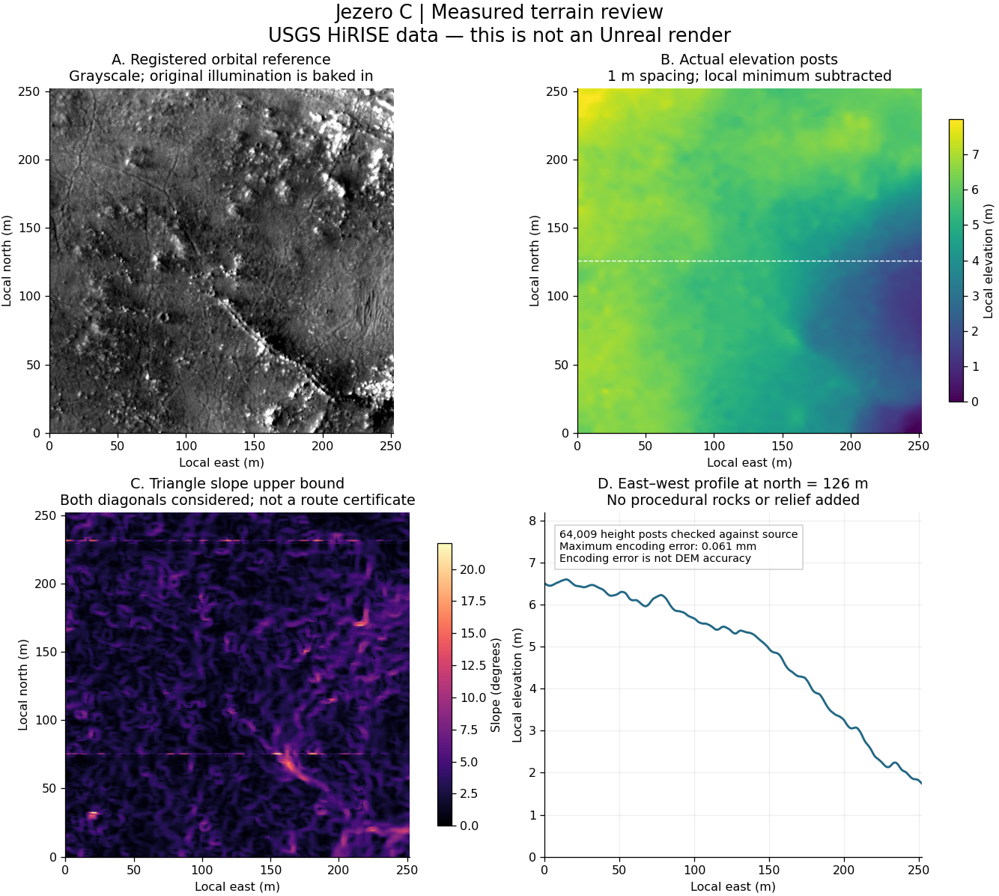

# Mars yüzeyinin bilimsel karşılığı ve operasyon sınırları

İnceleme: **28 Ekim 2026**. Sonuç: Jezero'nun ölçülmüş bir kesiti ve aynı yere
kayıtlı HiRISE görüntüsü veri paketinde gerçekten vardır. Kaynağa sadık aktarım,
Mars'taki her taşın doğru biçimde yeniden oluşturulması anlamına gelmez.
Bu ayrım özellikle tekerlek temasına ve kamera görüntülerine dayanarak rover
operasyonu değerlendirirken korunmalıdır.

## Neler temsil ediliyor?

| Özellik | Mevcut karşılık | Kanıt ve sınır |
|---|---|---|
| Yükseklik, geniş çukurlar, sırtlar, krater biçimi | USGS Jezero C stereo DTM'inden gerçek yükseklik alanı | Yalnızca seçilen 252 × 252 m kapsamda ve kaynak verinin çözebildiği ölçekte. Bütün Jezero veya Mars oluşturulmuş değildir. |
| Yüzey görünümü | Aynı alanın 1024 × 1024 gri HiRISE ortogörüntüsü | Gerçek kaynak görüntüdür; renk/albedo değildir, çekim ışığı ve gölgeleri içerir. |
| Eğim | Metre ölçeğinde ölçülmüş yüksekliklerden hesaplanır | Sonuç örnekleme aralığına ve üçgenlemeye bağlıdır; tek eşik sürülebilirliği kanıtlamaz. |
| Taşlar ve küçük çukurlar | Bazıları görüntüde seçilebilir | Görüntüde görünmeleri, yüksekliğinin/alt yüzeyinin veya çarpışma geometrisinin bilindiği anlamına gelmez. Otomatik 3B taş üretimi yoktur. |
| Mağara, çıkıntı altı, dikey duvar | Yok | Landscape, her XY için tek Z içeren 2,5B yükseklik alanıdır. |
| Kum, batma, kayma ve çekiş | Doğrulanmış karşılık yok | `soil.csv` sınır maskesidir. Jeolojik sınıf, sürtünme katsayısı veya taşıma gücü ölçümü değildir. |
| Atmosfer ve ışık | Fiziksel birimleri açık, literatürle sınırlandırılmış senaryo | Belirli bir sol/mevsim için spektral veya radyometrik kalibrasyon yapılmış değildir. |

## Örnek aralığı neden doğruluk değildir?

[HiRISE'ın bu gözlem kaydı](https://hirise.lpl.arizona.edu/ESP_045994_1985),
özgün görüntü ölçeğini yaklaşık **28,1 cm/piksel**, çözülebilen nesne boyutunu
yaklaşık **84 cm** olarak verir. Harita ürününün 25 cm/piksel olması 25 cm'lik
taşların biçiminin çözüldüğünü göstermez. Gözlem 19 Mayıs 2016'da, yerel Mars
saati 15:14 civarında alınmıştır; 2020 tarihi türetilmiş USGS ürününün yayın
tarihidir. Görüntü güncel veya belirlenen simülasyon saatine ait değildir.

[HiRISE DTM açıklaması](https://hirise.lpl.arizona.edu/dtm/about.php) ve
[Sutton ve diğerleri, 2022](https://doi.org/10.3390/rs14102403), 1–2 m post
aralığının efektif çözünürlük veya mutlak konum doğruluğuyla aynı olmadığını
açıklar. 1 m ürünler için genel düşey hassasiyet on santimetreler mertebesinde
olabilir; bu, seçtiğimiz her köşeye atanmış hata sınırı değildir. Stereo eşleme,
elle düzenleme, gölgeler, düşük doku ve datum/kontrol ağı ayrı belirsizliklerdir.

Paketin [özgün DTM metadata dosyası](../Content/Mars/Jezero/source_dem.xml),
stereo çifti, işlem geçmişini ve kontrol/bağıl kayıt bilgilerini içerir.
Metadata'daki ortogörüntüler arası 99. yüzdelikte 3 m'den iyi kayıt sonucu,
bu kesitin mutlak konumunun 3 m doğruluğunda olduğunun belgesi değildir.
Kesite özgü efektif çözünürlük, her post için yükseklik belirsizliği veya elle
düzenlenmiş alanları işaretleyen bir güven maskesi elimizde yoktur; raporda
bu alanlar bilinmiyor olarak tutulur.

## Gerçekleştirilen sayısal denetim

[Kaydedilmiş rapor](data/jezero-fidelity.json) ve
[yeniden çalıştırılabilir araç](../mars_rover/fidelity.py) şu ayrımı yapar:

1. **Kaynak kimliği:** Orijinal DTM'nin tam dosya SHA-256 değeri doğrulandı.
   DTM ve ortogörüntünün özgün FGDC XML dosyaları değiştirilmeden pakete eklendi;
   bunların da hash'leri editör öncesinde denetlenir. Git/Windows satır sonu
   dönüşümleri özgün metadata baytlarını değiştiremez.
2. **Yoğun geometri karşılaştırması:** 64.009 hedef postun her biri, ters CRS
   dönüşümü ve kaynak dört post üzerinde bağımsız bilineer hesapla karşılaştırıldı.
   GDAL'ın hazırlama warp'ı bu hesapta kullanılmadı. Bütün noktalar 0,000002 m
   sayısal toleransın içinde kaldı. Bu, iki hesabın uyuşmasıdır; yeni bir Mars
   saha doğruluğu ölçümü değildir.
3. **Kodlama:** CSV–r16 arasındaki en büyük yükseklik farkı yaklaşık **0,061 mm**;
   kaynak ölçüm hatasından çok küçüktür. Bu değer bilimsel arazi doğruluğu diye
   sunulmaz. Yükseklik farkı yaklaşık 7,989 m'dir.
4. **Ölçek:** Equirectangular `lat_ts=0` kaynak gridinin Jezero'daki doğu–batı
   zemin/grid oranı yaklaşık 0,9487174'tür. Yerel Mars projeksiyonu bu farkı ele
   alır. Metreler referans cisme aittir; kaynak düşey datum/yarıçap belirsizliği ve
   yükseklik nedeniyle gerçek yüzeydeki yatay mesafe birebir jeodezik garanti değildir.



Görsel incelemede eğim haritasında kuzey yaklaşık 75–76 m ve 231–232 m
civarında çizgisel izler görülüyor. Bunların tümünün fiziksel arazi mi, stereo
eşleme/düzenleme izi mi olduğu yalnızca bu veriyle doğrulanmış değildir.
Kaynak değerlerini koruduk; izleri yumuşatıp gerçek ölçüm gibi sunmadık.

## Eğim ve çarpışma denetimindeki düzeltme

| Hesap | Bu kesitte maksimum |
|---|---:|
| 2 m bazlı merkezî fark | 15,842° |
| 4 m bazlı merkezî fark | 14,443° |
| 10 m bazlı merkezî fark | 10,967° |
| 20 m bazlı merkezî fark | 7,088° |
| Her iki köşegeni kapsayan üçgen eğimi üst sınırı | 21,116° |

Önceki 15,84° sayısı yanlış bir yükseklik dönüşümü değildi; ancak daha kısa
ölçekli yüzeyin en dik eğimini anlatmıyordu. Üçgen üst sınırı da gerçek motorda
hangi köşegenin kullanıldığının ölçümü veya bir yerel taşın gerçek eğimi değildir.
Bu yüzden GNC'nin 15° eşiği tek başına güvenli güzergâh kabulü sayılamaz.
Teker çapı, dingil mesafesi, yerden açıklık, yan eğim ve durma davranışı ayrı
gereksinimlerdir.

Yeni editör akışı hem basit hem karmaşık Landscape çarpışmasını **mip 0**
olarak açıkça ayarlar. Bu küçük kesit için görünür geometri de LOD 0'a
sınırlandırılır. Büyük kesitlerde bunun performans maliyeti ayrıca ölçülmelidir.
[Epic'in çarpışma rehberi](https://dev.epicgames.com/documentation/en-us/unreal-engine/landscape-collision-guide-in-unreal-engine?application_version=5.7)
çarpışma mip'inin artırılmasının ayrıntıyı azalttığını açıklar.

Yükseklik geri okumasından sonra gerçek editörde **260 konumda 520 ışın sorgusu**
istenir. Örnekler iç bölgeyi, component/subsection sınırlarını, yükseklik
ekstremlerini, en büyük komşu yükseklik adımını ve kenar orta noktalarını kapsar.
İsabetin doğru Landscape'e ait olması ve decoded yüksekliğe 2 mm sayısal
toleransla uyması gerekir. Eksik veya farklı çarpışma haritayı başarılı diye
kaydettirmez. Bu örneklem bütün üçgenlerin, hareketli teker temasının veya
paketlenmiş oyunun denetimi değildir.

29 Ekim 2026'da kullanıcının UE 5.7.4 editöründe `simulation` modu için
gönderdiği [QA04 raporu](data/native-jezero-qa04.json), 260 konumda 520 native
sorgunun geçtiğini ve azami konum farkının yaklaşık 0,084 mm olduğunu bildirir.
Bu, burada belirtilen örneklerin beklenen kodlanmış yüksekliğe sayısal
uyumudur; Mars'ın gerçek yükselti doğruluğu, her üçgen veya teker teması
ölçümü değildir. QA04 raporu test edilen commit'i veya GPU modelini içermez.
Python testleri yalnızca denetim kurallarını sınar. `orbital_reference`,
`gpu_render_verified` ve `visual_qa_passed` için ayrı kanıt gerekir.

## Atmosfer: hangi sayı neyi ifade ediyor?

| Parametre | Mevcut değer ve dayanak |
|---|---|
| Yerçekimi | 3,71 m/s², nominal Mars değeri; yerel gravite haritası değildir. |
| Referans yarıçapı | DTM'nin 3396,19 km küresi; atmosferin yerel taban yarıçapında çıkarılan -2,580582 km yükseklik ofseti de hesaba katılır. |
| Gaz ölçek yüksekliği | NASA'nın nominal 11 km değeri. Zamanla değişen sıcaklık/basınç profili değildir. |
| Toz ölçek yüksekliği | Ayrı ayarlanabilir 11 km varsayımı; gazın ve tozun aynı profile sahip olduğu ölçülmüş değildir. |
| Toz optik derinliği | `tau880=0.45`, erken Jezero gözlemlerinde raporlanan 880 nm'deki 0,4–0,5 aralığının içinde bir senaryo. Belirli bir solun verisi değildir. |
| Tek saçılma albedosu | 0,93, TES güneş bandı çalışmalarındaki yaklaşık 0,92–0,94 aralığından hareketle seçilmiş senaryo. Jezero'ya ait RGB/880 nm ölçümü değildir. |
| Güneş açısal çapı | NASA nominal uzaklığı 227.956.000 km ve IAU nominal Güneş yarıçapıyla hesaplanan yaklaşık 0,3497°. Dünya ışığı varsayılanına bırakılmaz. |
| Işık, pozlama, gaz RGB katsayıları ve yüzey renkleri | Hâlâ kalibre edilmemiş görüntüleme tercihleri. 30.000 lux bir MEDA ölçümü değildir. |

Toz sönüm katsayısı artık bağımsız, keyfî RGB sayılarından seçilmez.
`beta(z)=beta(0) exp(-z/H)` modeli ve sonlu atmosfer yüksekliği için
`beta_ext(0)=tau/[H(1-exp(-h_top/H))]` hesaplanır. Saçılma `SSA × beta_ext`,
soğurma `(1-SSA) × beta_ext` olur. Birimler km⁻¹'dir; analitik sütun integrali
test edilir. **880 nm opaklığını RGB'ye gri yaklaşımla taşımak bir varsayımdır.**
Bu integralin tutması, Unreal'ın GPU çıktısının spektral kalibrasyonu değildir.

[Bell ve diğerleri, 2022](https://doi.org/10.1126/sciadv.abo4856) Jezero'da
mevsimsel optik derinlik değişimini gösterir.
[Clancy ve diğerleri, 2003](https://doi.org/10.1029/2003JE002058) ise güneş
bandı saçılma albedosu için bağlam sağlar. Bu iki çalışmanın farklı yer,
dalga boyu ve gözlemleri aynı ölçüm gibi birleştirilmez.
[MEDA/TIRS çalışmasındaki](https://doi.org/10.1029/2022JE007560) 9/12 µm
optik derinlikler de doğrudan görünür bant parametresi sayılamaz.

Dünya'nın varsayılan ozon katmanı kapatılır; bunun anlamı Mars'ta hiç ozon
olmadığı değildir. Ek sahte sis kullanılmaz. Gri aerosol ve tek Henyey–Greenstein
parametresi Mars'ın spektral toz saçılmasını, günbatımındaki mavi güneş çevresini,
bulutları veya toz fırtınası dinamiklerini doğrulamaz. Fotoğrafla renk karşılaştırması
için PDS/MEDA/SkyCam ölçümleri, gözlem saati, kamera cevabı ve spektral ışınım
aktarımı ayrıca gerekir.

## Daha ayrıntılı gerçek yüzey için incelenen açık kaynaklar

[USGS'nin 2025 MSR ürünü](https://astrogeology.usgs.gov/search/map/mars-sample-return-terrain-relative-navigation-hirise-dtm-mosaic)
batı krater kenarı kapsamı, ortogörüntü ve güven ürünleri sunar. Ancak
[Bland ve diğerleri, 2025](https://www.hou.usra.edu/meetings/lpsc2025/pdf/1627.pdf),
yeni ve eski HiRISE mozaiklerinin doğrudan kusursuz hizalı olmadığını gösterir:
aralarındaki fark 3 m içinde ancak yaklaşık %80 düzeyindedir. Güncel veri diye
sessizce değiştirmek veya güven maskesini okumadan birleştirmek uygun değildir.
Bu ürün bu geliştirmede içe aktarılmış değildir.

Tekerlek ölçeğindeki kaya geometrisi için daha güçlü yol, **rover üzerinde
çekilmiş stereo görüntülerden üretilmiş XYZ/mesh ürünleridir**.
[NASA-AMMOS Landform](https://github.com/NASA-AMMOS/Landform), Mars 2020 için
yüzey ve yörünge gözlemlerini birleştiren gerçek bir araçtır.
[Resmî veri bağlantıları](https://github.com/NASA-AMMOS/Landform/wiki/Links-to-Publicly-Available-Input-Data)
Navcam/Mastcam-Z kalibre görüntüleri, XYZ/UVW ürünleri ve OBJ mesh arşivlerini
tanımlar. [Kamera SIS belgesi](https://pds-geosciences.wustl.edu/m2020/urn-nasa-pds-mars2020_mission/document_camera/Mars2020_Camera_SIS.pdf)
ürün ve koordinat anlamlarının temelidir.

Landform'un README'si bazı operasyonel akışların özel görev servislerine ihtiyaç
duyduğunu ve bağlamsal mesh'lerin çoğunun herkese açık olmadığını da açıklar.
Dolayısıyla bunu tek tıkla hazır Mars dünyası diye sunmuyoruz. İlerleme yolu:
kamuya açık bir sol/mesh seçmek, rover/site frame'ini ve tarihini doğrulamak,
yerel DEM'e bağlamak, birimleri ve üçgenleri koruyarak Unreal'a almak, bindirme
alanında DEM ile çift çarpışmayı önlemek ve gerçek mesh üzerinde teker temasını
sınamaktır. Bu ayrıntılı mesh entegrasyonu henüz yapılmış değildir.

[NASA PDS MEDA arşivi](https://pds-atmospheres.nmsu.edu/data_and_services/atmospheres_data/PERSEVERANCE/meda.html)
basınç, sıcaklık, RDS, TIRS, rüzgâr, SkyCam ve geometri ürünlerini ayırır.
Bir sonraki atmosfer kalibrasyonu için sol, yerel güneş saati, Ls, dalga boyu,
kalite bayrakları ve sensördeki toz birikimi birlikte değerlendirilmelidir.
Ham RDS ışınımını toz optik derinliği diye adlandırmak doğru değildir.

## Tekrar çalıştırma

```bash
python -m pytest tests -q
python -m mars_rover.fidelity
python -m mars_rover.fidelity --source-dem .cache/mars/jezero_c.tif --output generated/audit-new.json
```

İlk audit paketin kendi tutarlılığını inceler; özgün GeoTIFF verilmeden yeni
bir kaynağa karşılaştırma yapılmış gibi davranmaz. Native Windows kabul komutu
ve iki görünümün kurulumu [Jezero rehberindedir](mars-jezero.md).
